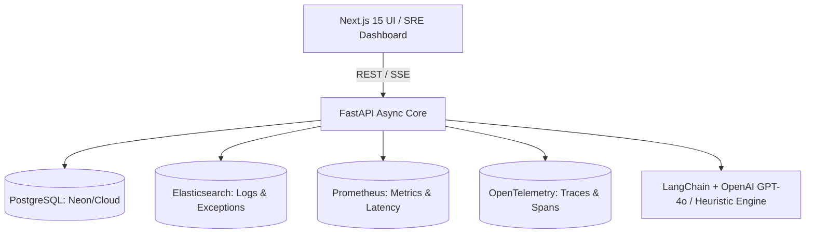

# Incident Root-Cause Analyzer (IncidentRootAI)

An enterprise-grade SRE platform that ingests real-time logs, metrics, distributed traces, and CI/CD events to **autonomously detect, correlate, and determine the root cause of production outages**.

---

## 🏛️ Architecture Overview



### Key Components

1. **Frontend (`/frontend`)**:
   - Built with **Next.js 15 App Router** and **Vanilla CSS tokens** (glassmorphism dark UI).
   - Real-time incident prioritization matrix (`Critical`, `High`, `Medium`).
   - SRE confidence score visualization, multi-signal correlation tabs, interactive timeline, and automated postmortem export.

2. **Backend (`/backend`)**:
   - **FastAPI** with async SQLAlchemy, Pydantic v2 schemas, and connection pooling.
   - **Prometheus Service**: Range queries for latency ($p99$), HTTP $5xx$ error surges, CPU/RAM starvation.
   - **Elasticsearch Service**: Clustered exception retrieval and error burst frequency analysis.
   - **OpenTelemetry Service**: Automated bottleneck discovery across distributed span waterfalls and service topology mapping.
   - **RCA Engine**: Hybrid engine pairing rule-based causal graphs with LangChain LLM reasoning.

---

## 🚀 Getting Started

### 1. Local Development (Backend)
```bash
cd backend
python -m venv venv
venv\Scripts\activate
pip install -r requirements.txt
cp .env.example .env
uvicorn app.main:app --reload --port 8000
```
Swagger API docs available at: `http://localhost:8000/docs`

### 2. Local Development (Frontend)
```bash
cd frontend
npm install
npm run dev
```
Open `http://localhost:3000` to access the dashboard.

### 3. Docker Deployment
```bash
docker-compose up -d
```
Spins up:
- Next.js UI (`:3000`)
- FastAPI Backend (`:8000`)
- PostgreSQL (`:5432`)
- Elasticsearch (`:9200`)
- Prometheus (`:9090`)
- Redis (`:6379`)
